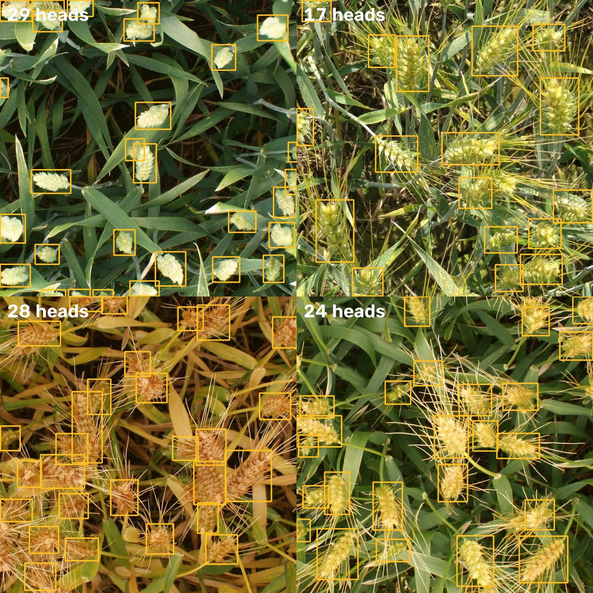

# Global Wheat Detection

## Why it matters
Counting wheat heads in field photos tells breeders and farmers how dense a crop is and how much it will yield. Done by hand it is slow, and a model trained on one farm often fails on the next, because varieties, growth stages, lighting and camera setups all change. The training photos come from seven research sites in France, Switzerland, the UK and Canada.

## Data
3,422 photos at 1024 × 1024 px with 147,793 boxed wheat heads, often 40 to 100 per photo, many overlapping or cut off at the edges. 49 photos contain no wheat heads at all.

## Method
- **Model:** YOLO26-m (Ultralytics), starting from COCO-pretrained weights, trained at the full 1024 px resolution for 40 epochs (2.7 hours on a Kaggle GPU).
- **Augmentation:** mosaic (turned off for the last 8 epochs), vertical and horizontal flips, light mixup and colour jitter. Wheat seen from above has no "up", so vertical flips are safe.
- **Validation:** 514 photos (15%) held out and never trained on, stratified by research site so every site is represented.
- **Metric:** the competition's own metric, written from scratch and unit-tested: for each photo, TP / (TP + FP + FN) averaged over IoU thresholds 0.50 to 0.75. It punishes both missed heads and extra boxes, and it is stricter than the usual mAP@0.5.
- **No tuning on the reported number:** the confidence threshold and test-time augmentation were chosen on one half of the held-out photos, and the score is reported on the other half.

## Results (held-out photos)

| Metric | Value |
|---|---|
| **Competition mAP @ IoU 0.50–0.75 (reported half)** | **0.70** (0.698) |
| Same metric, all 514 held-out photos | 0.694 |
| COCO-style mAP @ 0.50–0.95 (Ultralytics) | 0.576 |
| Chosen settings | confidence 0.4, with flip TTA |

**No sign of overfitting:** validation box loss falls steadily from 1.73 to 1.43 over the 40 epochs and ends level with the training loss (1.43), and validation mAP is still flat-to-rising at the end (see `results/results.png`).

**By research site** (all held-out photos):

| Site | Photos | Score |
|---|---|---|
| rres_1 (UK) | 65 | 0.825 |
| inrae_1 (France) | 26 | 0.803 |
| ethz_1 (Switzerland) | 112 | 0.758 |
| usask_1 (Canada) | 30 | 0.690 |
| arvalis_3 (France) | 84 | 0.689 |
| arvalis_1 (France) | 159 | 0.619 |
| arvalis_2 (France) | 31 | 0.502 |

**Where it fails:** the Arvalis sites are hardest. Their photos are of ripe, yellow wheat where heads and leaves have similar colours, and arvalis_2 has heads packed so tightly that boxes merge or split. The held-out photos come from the same sites as the training photos, so this score is not a test of new sites. The competition's hidden test set used different sites, and its top scores were around 0.76.

*Predictions on four of the competition's test photos, which have no public labels and were never seen in training.*

## Run it

All the code is in one notebook, [global_wheat_detection.ipynb](global_wheat_detection.ipynb), with an explanation before each step of what it does, why and how it works: data preparation, training, the competition metric, evaluation and the prediction figure.

Open it on Kaggle, attach the Global Wheat Detection competition data, turn on a GPU and internet, and run all cells (about 2.7 hours).

`results/metrics.json` has all scores, the threshold sweep and per-site results. `results/results.csv` has the training curves. The trained weights (`best.pt`, 43 MB) are an output of the Kaggle run.
